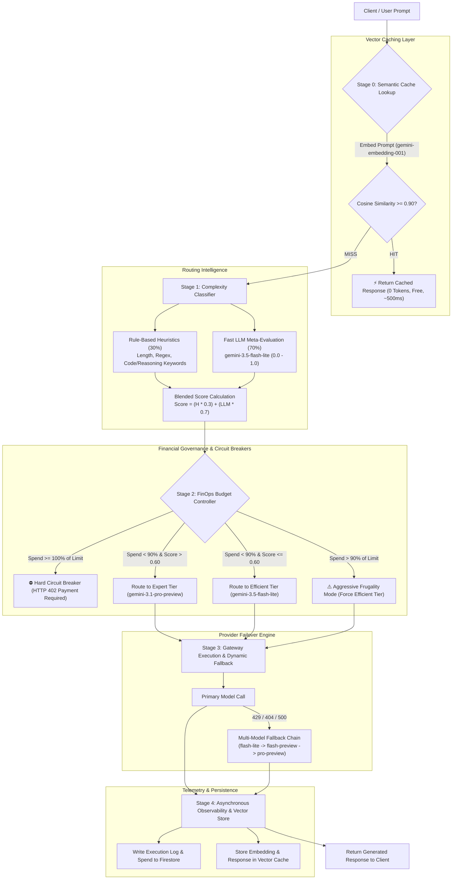

<div align="center">


# AI Model Router & FinOps Budget Gateway

[](https://www.typescriptlang.org/)
[](https://react.dev/)
[](https://expressjs.com/)
[](https://tailwindcss.com/)
[](https://nodejs.org/api/test.html)
[](LICENSE)

An intelligent, production-grade LLM API gateway and FinOps proxy. It performs **sub-millisecond semantic vector caching**, **dual-stage complexity classification** (heuristics + fast LLM meta-scoring), **dynamic model tier routing**, and **strict financial circuit-breaking** to prevent API cost overruns and rate-limit outages.
</div>

---

## 📌 Problem & Motivation

Uncontrolled LLM consumption leads to three critical failure modes in production:
1. **Financial Runaway:** Trivial requests (greetings, simple summaries) sent to high-cost frontier reasoning models burn API credits unnecessarily.
2. **Rate Limit Exhaustion:** Free and standard tier APIs frequently hit quota ceilings (HTTP 429) without built-in automated failover.
3. **Repeated Query Inefficiency:** Identical or semantically equivalent queries repeatedly query external LLMs rather than resolving locally from vector memory.

The **AI Model Router & FinOps Gateway** solves this by inserting an intelligent proxy layer between client applications and model providers.

---

## 🏗️ System Architecture



---

## ✨ Key Features

### 1. Sub-Millisecond Semantic Vector Cache
- Generates 768-dimensional dense vector embeddings using Google's `gemini-embedding-001` (with automatic fallback to `gemini-embedding-2`).
- Evaluates **normalized cosine similarity**:
  $$\text{Cosine Similarity}(\vec{A}, \vec{B}) = \frac{\sum_{i=1}^{n} A_i B_i}{\sqrt{\sum_{i=1}^{n} A_i^2} \cdot \sqrt{\sum_{i=1}^{n} B_i^2}}$$
- Configured threshold ($\ge 0.90$) captures paraphrased and semantically equivalent queries.
- **Zero-token consumption** and instantaneous response generation.
- **Dual-Layer Persistence:** Primary storage in Firestore with automatic seamless in-memory fallback for local environments without cloud write privileges.

### 2. Dual-Stage Complexity Classifier
- Combines instantaneous regex-based heuristics with an ultra-lightweight LLM classifier:
  $$\text{Difficulty} = 0.3 \cdot \text{Heuristic Score} + 0.7 \cdot \text{LLM Score}$$
- Heuristic signals:
  - Base difficulty: `0.1`
  - Long input ($>500$ characters): `+0.3`
  - Explanatory/analytical queries (`explain`, `analyze`, `compare`): `+0.2`
  - Code/debugging tasks (`code`, `function`, `debug`): `+0.4`
  - Step-by-step reasoning (`step-by-step`, `reasoning`): `+0.3`
- If difficulty exceeds `0.60`, queries are escalated to the reasoning model (`gemini-3.1-pro-preview`); otherwise routed to the efficient tier (`gemini-3.5-flash-lite`).

### 3. FinOps Budget Controller & Circuit Breakers
- **Real-Time Financial Tracking:** Cumulative spend tracked down to fractions of a cent ($0.0001).
- **Aggressive Frugality Shift ($>90\%$):** Automatically forces complex queries to the efficient tier when monthly spend exceeds 90% of budget limit.
- **Hard Circuit Breaker ($100\%$):** Terminates outbound requests with `HTTP 402 Payment Required` upon reaching or exceeding budget limit, halting API costs immediately.

### 4. Multi-Model Provider Gateway with Auto-Fallback
- Resilient retry and failover engine.
- Automatically handles API deprecation notices and quota saturation (HTTP 429 `RESOURCE_EXHAUSTED` free-tier limits) by cascading requests across compatible model families.

### 5. Interactive Live Control Center (UI)
- **01 / Overview:** Financial gauges, real-time budget burn rate, uptime tracking, model distribution charts, and cache efficiency metrics.
- **02 / Playground:** Interactive query testing console displaying routing rationale, token cost, difficulty score, and response latency.
- **03 / Archive:** Detailed audit log table showing every transaction, provider, tier, and cache hit status.
- **04 / Controls:** Runtime configuration forms to update monthly budget limit, request timeouts, retry attempts, and active model names with instant hot-reloading.

---

## 🛠️ Tech Stack

| Domain | Technologies |
|---|---|
| **Frontend** | React 19, TypeScript, Tailwind CSS v4, Lucide Icons, Recharts, Motion |
| **Backend & Proxy** | Node.js, Express, TypeScript, Vite (HMR & Dev Server) |
| **AI / Embeddings** | Google Gemini API (`@google/genai`), `gemini-embedding-001`, `gemini-3.5-flash-lite`, `gemini-3.1-pro-preview` |
| **Data & State** | Firebase Firestore + Dual-Layer Local In-Memory Cache Fallback |
| **Testing** | Node.js Native Test Runner (`node:test`, `node:assert/strict`), `tsx` |

---

## 🧪 Automated Test Suite

The core routing, classification, budget enforcement, and similarity logic is thoroughly tested using Node's native test runner without third-party test bloat.

To run the full suite:
```bash
npm test
```

### Test Coverage Summary (20 Tests / 3 Suites)

#### `tests/similarity.test.ts` — Vector Cosine Similarity Engine
- [x] Returns `1.0` for identical vectors
- [x] Returns `0.0` for perfectly orthogonal vectors
- [x] Returns `-1.0` for opposite vectors
- [x] Detects high semantic similarity above `0.90` threshold
- [x] Rejects low semantic similarity below `0.90` threshold
- [x] Safely handles empty, null, or zero-magnitude vectors without division by zero

#### `tests/classifier.test.ts` — Complexity Classifier & Heuristics
- [x] Assigns baseline difficulty (`0.1`) for simple greetings
- [x] Adds `+0.2` weight for explanation and analysis keywords
- [x] Adds `+0.4` weight for coding and debugging keywords
- [x] Adds `+0.3` weight for step-by-step reasoning keywords
- [x] Adds `+0.3` weight for long queries ($>500$ characters)
- [x] Combines multiple signals for complex technical prompts
- [x] Clamps scores strictly between `0.0` and `1.0`
- [x] Blends heuristic score (30%) with LLM meta-score (70%) accurately

#### `tests/budget.test.ts` — FinOps Budget Enforcer & Circuit Breakers
- [x] Routes easy queries to efficient tier when budget is healthy
- [x] Routes complex queries to expert tier when budget is healthy
- [x] Activates aggressive frugality ($>90\%$ spend) and forces complex queries to efficient tier
- [x] Triggers hard suspension (`HTTP 402`) when budget is 100% exhausted
- [x] Triggers hard suspension when spending exceeds limit ($>100\%$)
- [x] Handles zero or negative budget safely without crashing

---

## 🚀 Quickstart & Local Demonstration

### Prerequisites
- Node.js 18 or higher
- Google Gemini API Key ([Google AI Studio](https://aistudio.google.com/))
- Firebase project configuration (pre-bundled in repo)

### 1. Clone & Install
```bash
git clone https://github.com/your-username/ai-model-router-and-budget-gateway.git
cd ai-model-router-and-budget-gateway
npm install
```

### 2. Configure Environment Variables
Create a `.env` file in the project root:
```env
GEMINI_API_KEY="your_google_gemini_api_key_here"
```

### 3. Run Automated Tests
```bash
npm test
```
Expected output: `20 pass, 0 fail` across 3 test suites.

### 4. Start Development Gateway
```bash
npm run dev
```
Open your browser to `http://localhost:3000`.

---

## 🎮 Live Demonstration Scenarios

### Scenario A: Efficient Tier Routing (Cost Minimization)
1. In the **02 / Playground** tab, input a basic query:
   ```text
   What are three good habits for healthy sleep?
   ```
2. Click **Execute Route**.
3. **Observed Outcome:**
   - Complexity score evaluated below `60%`.
   - Gateway routes request to `gemini-3.5-flash-lite` (Efficient Tier).
   - Execution cost is recorded at sub-cent rates ($\approx \$0.00010$).

### Scenario B: Expert Tier Escalation (Reasoning Required)
1. Input a technical coding and analytical query:
   ```text
   Write a step-by-step Python function to debug and detect memory leaks in a multiprocessing queue, and explain the garbage collection internals.
   ```
2. Click **Execute Route**.
3. **Observed Outcome:**
   - Heuristics detect `step-by-step`, `function`, `debug`, `explain`.
   - Difficulty exceeds the `60%` threshold.
   - Gateway escalates to `gemini-3.1-pro-preview` (Expert Tier).

### Scenario C: Semantic Vector Cache Hit (Zero-Token Latency)
1. Run an initial technical query:
   ```text
   What is quantum entanglement? Explain in three simple bullet points.
   ```
2. Prompt is executed via LLM, and its vector embedding is indexed.
3. Immediately submit a rephrased query:
   ```text
   Can you explain quantum entanglement in 3 simple bullets?
   ```
4. **Observed Outcome:**
   - Vector similarity matches at **$\approx 97.7\%$** ($\ge 90\%$ threshold).
   - Instant response returned in $\approx 500\text{ms}$.
   - Response banner flags `⚡ SEMANTIC VECTOR CACHE HIT`.
   - Cost: **`$0.00000 (Free)`** — zero external LLM tokens consumed.

### Scenario D: FinOps Circuit Breaker (HTTP 402 Suspension)
1. Navigate to the **04 / Controls** tab.
2. Set **Monthly Budget ($)** to `$0.0001` (below current total spend) and click **Save Parameters**.
3. Return to **02 / Playground** and attempt to submit any prompt.
4. **Observed Outcome:**
   - Gateway rejects request with `HTTP 402 Payment Required`.
   - UI displays clear red warning banner: *"Monthly budget exhausted. Service suspended until reset."*
   - No external provider API calls are made.

---

## 💼 Career & Portfolio Showcase

Looking for resume bullet points, interview talking points, or demonstration recording scripts?  
See the [Portfolio & Career Showcase Guide](SHOWCASE.md) for ready-to-use resume bullets across AI/LLM, Full-Stack, and FinOps tracks, plus recording walkthroughs and technical interview Q&A.

---

## 📄 License

This project is licensed under the MIT License - see the [LICENSE](LICENSE) file for details.
